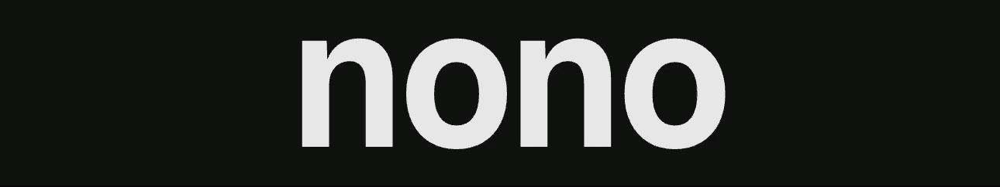

<div align="center">



<p>
  Built by the team that brought you
  <a href="https://sigstore.dev"><strong>Sigstore</strong></a>
  <br/>
  <sub>The standard for secure software attestation, used by PyPI, npm, brew, and Maven Central</sub>
</p>
<p>
  <a href="https://opensource.org/licenses/Apache-2.0"></a>
  <a href="https://github.com/nolabs-ai/nono/actions/workflows/ci.yml"></a>
  <a href="https://www.bestpractices.dev/projects/13332"></a>
  <a href="https://docs.nono.sh"></a>
</p>
<p>
  <a href="https://discord.gg/G6qDa7cC7x">
    
  </a>
   <a href="https://nolabs.ai/careers">
      
  </a>
  <a href="https://github.com/marketplace/actions/agent-sign">
    
  </a>
</p>

---
</div>

> [!NOTE]
> In the lead-up to a 1.0 release, APIs are stabilizing. API changes may still occur where necessary, but will be kept to a minimum.

**nono is a complete agent runtime security tool.** Secure your agents, their tools, their credentials, and the skills and instructions they follow, with low latency, a minimal footprint, and zero setup. Kernel-enforced sandboxing is the foundation for a complete workflow of protection, verification, audit, and recovery.

Bring your agent: Claude Code, Codex, Copilot, OpenCode, Goose, OpenClaw, Hermes, Pi, or your own built with frameworks like ADK, Mastra, Pydantic AI and LangChain. With ease you can onboard your own custom developed agents into nono’s secure environment, and immediately benefit from its comprehensive security features.

nono supports macOS, Linux, and Windows (WSL2).

**Unprivileged, and runs anywhere.** A single binary, with no root privileges required. Run nono on a developer’s laptop, inside a Kubernetes pod, in a CI workflow, a container, or a microVM. It composes with your existing infrastructure for defence in depth.

## What nono protects

- **[Tools](https://nono.sh/docs/cli/features/tool-sandbox)** — Run each tool in its own ephemeral sandbox, isolated from the agent and other tools, with explicit permissions for files, network access, environment variables, and credentials. Control which commands the agent can call and which tools can call one another.
- **[Credentials](https://nono.sh/docs/cli/features/credential-injection)** — Keep API keys outside the agent’s sandbox with proxy-based injection and accessable to a single tool if need be. Use phantom tokens to restrict credential use to approved tools.
- **[Network access](https://nono.sh/docs/cli/features/networking)** — Control where agents connect and what they can do there, with domain filtering and API rules for HTTP methods and paths.
- **[Supply chain and skill attestation](https://nono.sh/docs/cli/features/trust)** — Verify the origin and integrity of skills, hooks, and instruction files with Sigstore. Define which publishers you trust and reject unsigned or tampered files covered by your policy.
- **[Cryptographic audit](https://nono.sh/docs/cli/features/audit)** — Keep a tamper-evident record of agent sessions and security decisions, with integrity verification and optional signing.
- **[Rollback and recovery](https://nono.sh/docs/cli/features/atomic-rollbacks)** — Review file changes and restore tracked files from verified snapshots when an agent takes a wrong turn.

**Your policies stay outside the agent’s control.** Define them in composable profiles and enforce rules such as:

- The `aws` CLI can use a credential, but `curl` can’t.
- `gh` can read issues and PRs, but can only post to `org/foo`.
- `git` can call `ssh` under its own policy, while the agent cannot call `ssh` directly.

---

## Quickstart

#### curl

```bash
curl -fsSL https://nono.sh/install.sh | sh
```

#### macOS / Linux (Homebrew)
```bash
brew install nono
```

#### Nix

The project provides a Nix flake with two outputs:

- `#default` (from source) — builds from source using `buildRustPackage` (first run compiles the crate and its dependencies)
- `#prebuilt` — fetches the official release binary from GitHub Releases (fast, no compilation)

```bash
# Run without installing (from source)
nix run github:nolabs-ai/nono

# Run the prebuilt binary (no compilation)
nix run github:nolabs-ai/nono#prebuilt

# Install into your profile
nix profile add github:nolabs-ai/nono

# Pin to the latest release
nix run "github:nolabs-ai/nono?ref=$(curl -fsSL https://api.github.com/repos/nolabs-ai/nono/releases/latest | jq -r .tag_name)"
```

**Other platforms** — Debian/Ubuntu, Fedora, Arch, RHEL, openSUSE, WSL2: [see install instructions](https://nono.sh/docs/cli/getting_started/installation).

## Run it!

Search for an agent in the registry, then run it:

```bash
nono search pi
nono pull nolabs-ai/pi
nono run --profile nolabs-ai/pi -- pi
```

That's it. Pi now runs with the reviewed capabilities supplied by the pack. nono shows the exact filesystem, network, and credential access before applying the sandbox.

Profiles for all the popular agents live at [registry.nono.sh](https://registry.nono.sh), secured and ready to pull. Each one bundles the right filesystem scope, network allowlist, hooks, skills and more.

## Make it your own!

Outgrow the defaults? Scaffold a profile and tweak it — same command you already know:

```bash
nono profile init pi-local --extends nolabs-ai/pi
nono run --profile pi-local -- pi
```

`nono profile init` exports an extended and editable profile file for your agent, that inherits from the specified base profile. That profile is composable JSON, so you can review the exact filesystem, network, credentials, and tool rules before sharing it with a team or publishing it for the community.

Are you an agent developer and want to publish your own agent package? We would love to have you and promote your work! [See the docs](https://nono.sh/docs/cli/features/package-publishing).
## Ready to go deep?

Head over to the [docs](https://nono.sh/docs) and discover nono's rich composable policy system, credentials injection, L7 filtering, supply chain security, rollback, multiplexing, audit and more.

## Library support

nono provides FFI bindings for Rust and Python.

Also available as [Python](https://github.com/nolabs-ai/nono-py) bindings.

## Contributing

We encourage using AI tools to contribute. However, you must understand and carefully review any AI-generated code before submitting. Security is paramount. If you don't understand how a change works, ask in [Discord](https://discord.gg/G6qDa7cC7x) first.

## Security

If you discover a security vulnerability, please **do not open a public issue**. Follow the process in our [Security Policy](https://github.com/nolabs-ai/nono/security).

## License

Apache-2.0
